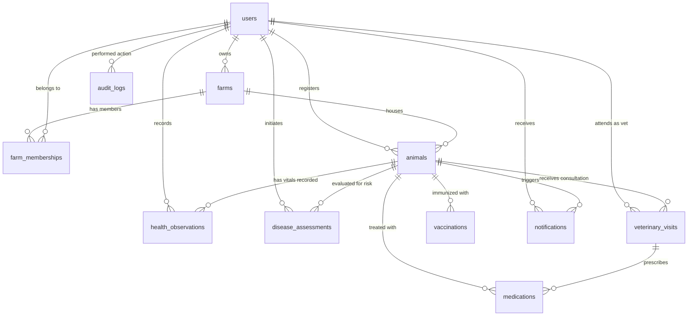

# Database Design: Livestock Health Monitoring System

This document provides the complete relational database schema design, entity relationships, integrity constraints, and indexing strategy for `livestock_health_monitoring`.

---

## 1. Entity-Relationship Diagram (ERD)

---

## 2. Table Specifications

### 1. `users`
Stores user identities, credentials, and access roles.

| Column | Type | Constraints | Description |
| :--- | :--- | :--- | :--- |
| `id` | INTEGER | PRIMARY KEY, AUTOINCREMENT | Unique user identifier |
| `full_name` | VARCHAR(120) | NOT NULL | User's full legal name |
| `email` | VARCHAR(120) | UNIQUE, NOT NULL, INDEX | Login email address |
| `password_hash` | VARCHAR(255) | NOT NULL | Werkzeug scrypt/pbkdf2 hash |
| `role` | VARCHAR(30) | NOT NULL, DEFAULT 'farmer' | farmer, veterinarian, farm_manager, administrator |
| `phone` | VARCHAR(30) | NULLABLE | Contact telephone |
| `account_status` | VARCHAR(20) | NOT NULL, DEFAULT 'active' | active, suspended, pending |
| `created_at` | DATETIME | NOT NULL | Timestamp of registration |
| `updated_at` | DATETIME | NOT NULL | Timestamp of last profile update |

---

### 2. `farms`
Represents registered farms, ranches, or dairy facilities.

| Column | Type | Constraints | Description |
| :--- | :--- | :--- | :--- |
| `id` | INTEGER | PRIMARY KEY, AUTOINCREMENT | Unique farm identifier |
| `farm_name` | VARCHAR(150) | NOT NULL | Facility commercial name |
| `owner_id` | INTEGER | FOREIGN KEY (`users.id`), NOT NULL | Farm owner |
| `location` | VARCHAR(255) | NULLABLE | Geographic address / district |
| `farm_type` | VARCHAR(50) | NOT NULL, DEFAULT 'Dairy' | Dairy, Pastoral, Mixed, Breeding |
| `status` | VARCHAR(20) | NOT NULL, DEFAULT 'active' | active, inactive |
| `created_at` | DATETIME | NOT NULL | Creation timestamp |
| `updated_at` | DATETIME | NOT NULL | Last modified timestamp |

---

### 3. `farm_memberships`
Enables collaborative multi-user access to farm records.

| Column | Type | Constraints | Description |
| :--- | :--- | :--- | :--- |
| `id` | INTEGER | PRIMARY KEY, AUTOINCREMENT | Membership ID |
| `farm_id` | INTEGER | FOREIGN KEY (`farms.id`), NOT NULL | Associated farm |
| `user_id` | INTEGER | FOREIGN KEY (`users.id`), NOT NULL | Assigned user |
| `permission_level` | VARCHAR(30) | NOT NULL, DEFAULT 'view' | view, edit, admin |
| `created_at` | DATETIME | NOT NULL | Grant timestamp |

---

### 4. `animals`
Core individual animal entity.

| Column | Type | Constraints | Description |
| :--- | :--- | :--- | :--- |
| `id` | INTEGER | PRIMARY KEY, AUTOINCREMENT | System animal ID |
| `farm_id` | INTEGER | FOREIGN KEY (`farms.id`), NOT NULL, INDEX | Housing farm |
| `owner_id` | INTEGER | FOREIGN KEY (`users.id`), NOT NULL, INDEX | Legal owner |
| `animal_tag` | VARCHAR(64) | NOT NULL, INDEX | Ear tag / RFID tag identifier |
| `animal_name` | VARCHAR(100) | NULLABLE | Familiar animal name |
| `species` | VARCHAR(30) | NOT NULL, INDEX | Cow, Buffalo, Goat, Sheep |
| `breed` | VARCHAR(100) | NULLABLE | Breed designation |
| `sex` | VARCHAR(10) | NOT NULL, DEFAULT 'Female' | Female, Male |
| `date_of_birth` | DATE | NULLABLE | Exact birth date |
| `estimated_age_months` | INTEGER | NULLABLE | Age in completed months |
| `weight_kg` | FLOAT | NULLABLE | Weight in kilograms |
| `production_purpose` | VARCHAR(50) | NOT NULL, DEFAULT 'Dairy' | Dairy, Meat, Breeding, Wool, Multi-purpose |
| `image_path` | VARCHAR(255) | NULLABLE | Relative path to static photo |
| `status` | VARCHAR(30) | NOT NULL, DEFAULT 'Active' | Active, Sick, Quarantine, Sold, Deceased, Archived |
| `health_status` | VARCHAR(50) | NOT NULL, DEFAULT 'Normal' | Normal, Monitoring Required, Attention Required, Urgent Veterinary Attention, Prediction Unavailable |
| `notes` | TEXT | NULLABLE | Physical markings and pedigree notes |
| `created_at` | DATETIME | NOT NULL | Registration timestamp |
| `updated_at` | DATETIME | NOT NULL | Last update timestamp |

---

### 5. `health_observations`
Time-series physiological and behavioral observation logs.

| Column | Type | Constraints | Description |
| :--- | :--- | :--- | :--- |
| `id` | INTEGER | PRIMARY KEY, AUTOINCREMENT | Observation ID |
| `animal_id` | INTEGER | FOREIGN KEY (`animals.id`), NOT NULL, INDEX | Subject animal |
| `recorded_by` | INTEGER | FOREIGN KEY (`users.id`), NOT NULL | Observer user ID |
| `observed_at` | DATETIME | NOT NULL | Clinical observation time |
| `temperature_c` | FLOAT | NULLABLE | Rectal temperature in °C |
| `heart_rate_bpm` | FLOAT | NULLABLE | Pulse in beats per minute |
| `respiratory_rate_bpm` | FLOAT | NULLABLE | Breaths per minute |
| `weight_kg` | FLOAT | NULLABLE | Measured weight |
| `food_intake` | VARCHAR(30) | NULLABLE | Normal, Reduced, Anorexic, Increased |
| `water_intake` | VARCHAR(30) | NULLABLE | Normal, Reduced, Excessive, None |
| `walking_activity` | VARCHAR(30) | NULLABLE | Normal, Sluggish, Lame, Staggering, Recumbent |
| `grazing_activity` | VARCHAR(30) | NULLABLE | Normal, Reduced, Not Grazing, N/A |
| `rumination` | VARCHAR(30) | NULLABLE | Normal, Reduced, Absent, N/A |
| `resting_behavior` | VARCHAR(30) | NULLABLE | Normal, Restless, Lethargic, Isolated |
| `milk_production` | FLOAT | NULLABLE | Daily milk yield in liters |
| `body_condition_score` | FLOAT | NULLABLE | BCS (1.0 to 5.0) |
| `symptoms` | TEXT | NULLABLE | JSON list of observed clinical symptoms |
| `additional_notes` | TEXT | NULLABLE | Contextual field observations |
| `data_source` | VARCHAR(30) | NOT NULL, DEFAULT 'manual' | manual, sensor, veterinary_check |
| `created_at` | DATETIME | NOT NULL | System record creation timestamp |

---

### 6. `disease_assessments`
Immutable historical snapshot of algorithmic predictions and risk evaluations.

| Column | Type | Constraints | Description |
| :--- | :--- | :--- | :--- |
| `id` | INTEGER | PRIMARY KEY, AUTOINCREMENT | Assessment ID |
| `animal_id` | INTEGER | FOREIGN KEY (`animals.id`), NOT NULL, INDEX | Subject animal |
| `initiated_by` | INTEGER | FOREIGN KEY (`users.id`), NOT NULL | Initiating user |
| `model_name` | VARCHAR(100) | NOT NULL | Algorithm identifier |
| `model_version` | VARCHAR(50) | NOT NULL | Model pipeline version |
| `input_snapshot` | TEXT | NOT NULL | JSON dictionary of exact feature inputs |
| `predicted_class` | VARCHAR(100) | NOT NULL | Output condition / risk category |
| `prediction_scores` | TEXT | NULLABLE | JSON dictionary of class probabilities |
| `data_quality_status` | VARCHAR(50) | NOT NULL, DEFAULT 'Complete' | Complete, Imputed, Warning |
| `assessment_status` | VARCHAR(50) | NOT NULL, DEFAULT 'Completed' | Completed, Demo Mode, Failed |
| `risk_level` | VARCHAR(50) | NOT NULL, DEFAULT 'Normal' | Normal, Low, Moderate, High, Critical |
| `urgency_override` | BOOLEAN | NOT NULL, DEFAULT FALSE | True if severe symptoms overrode model output |
| `veterinary_notes` | TEXT | NULLABLE | Attending doctor's clinical review |
| `created_at` | DATETIME | NOT NULL | Inference execution timestamp |

---

### 7. `veterinary_visits`
Official clinical consultation records by licensed practitioners.

| Column | Type | Constraints | Description |
| :--- | :--- | :--- | :--- |
| `id` | INTEGER | PRIMARY KEY, AUTOINCREMENT | Visit ID |
| `animal_id` | INTEGER | FOREIGN KEY (`animals.id`), NOT NULL, INDEX | Subject animal |
| `veterinarian_id` | INTEGER | FOREIGN KEY (`users.id`), NULLABLE | Attending vet user ID (if registered) |
| `vet_name` | VARCHAR(120) | NULLABLE | External clinic or doctor name |
| `visit_date` | DATETIME | NOT NULL | Consultation datetime |
| `reason` | VARCHAR(255) | NOT NULL | Primary clinical chief complaint |
| `clinical_findings` | TEXT | NULLABLE | Objective veterinary examination findings |
| `veterinarian_diagnosis`| VARCHAR(255) | NULLABLE | Certified diagnosis |
| `treatment_notes` | TEXT | NULLABLE | Treatment and therapy instructions |
| `follow_up_date` | DATE | NULLABLE | Scheduled re-examination date |
| `outcome_notes` | TEXT | NULLABLE | Prognosis / follow-up notes |
| `created_at` | DATETIME | NOT NULL | Creation timestamp |
| `updated_at` | DATETIME | NOT NULL | Last modified timestamp |

---

### 8. `medications`
Prescribed therapeutic drugs and treatment courses.

| Column | Type | Constraints | Description |
| :--- | :--- | :--- | :--- |
| `id` | INTEGER | PRIMARY KEY, AUTOINCREMENT | Medication ID |
| `animal_id` | INTEGER | FOREIGN KEY (`animals.id`), NOT NULL, INDEX | Subject animal |
| `veterinary_visit_id` | INTEGER | FOREIGN KEY (`veterinary_visits.id`), NULLABLE | Related consultation |
| `medication_name` | VARCHAR(150) | NOT NULL | Drug commercial/generic name |
| `dosage_instructions` | TEXT | NOT NULL | Route, frequency, and dosage instructions |
| `start_date` | DATE | NOT NULL | Course start date |
| `end_date` | DATE | NULLABLE | Course end date |
| `prescribing_veterinarian` | VARCHAR(120) | NULLABLE | Prescribing practitioner |
| `status` | VARCHAR(30) | NOT NULL, DEFAULT 'Active' | Active, Completed, Discontinued |
| `created_at` | DATETIME | NOT NULL | Record creation timestamp |

---

### 9. `vaccinations`
Immunization schedules and preventive treatments.

| Column | Type | Constraints | Description |
| :--- | :--- | :--- | :--- |
| `id` | INTEGER | PRIMARY KEY, AUTOINCREMENT | Vaccination ID |
| `animal_id` | INTEGER | FOREIGN KEY (`animals.id`), NOT NULL, INDEX | Subject animal |
| `vaccine_name` | VARCHAR(150) | NOT NULL | Immunization agent |
| `vaccination_date` | DATE | NOT NULL | Administered date |
| `next_due_date` | DATE | NULLABLE | Booster / next dose due date |
| `administered_by` | VARCHAR(120) | NULLABLE | Vaccinator / Doctor |
| `batch_reference` | VARCHAR(100) | NULLABLE | Lot/batch number |
| `status` | VARCHAR(30) | NOT NULL, DEFAULT 'Completed' | Completed, Upcoming, Due Today, Overdue, Cancelled |
| `notes` | TEXT | NULLABLE | Observations / injection site notes |
| `created_at` | DATETIME | NOT NULL | Creation timestamp |

---

### 10. `notifications`
In-app clinical alerts and due date reminders.

| Column | Type | Constraints | Description |
| :--- | :--- | :--- | :--- |
| `id` | INTEGER | PRIMARY KEY, AUTOINCREMENT | Alert ID |
| `user_id` | INTEGER | FOREIGN KEY (`users.id`), NOT NULL, INDEX | Target recipient |
| `animal_id` | INTEGER | FOREIGN KEY (`animals.id`), NULLABLE | Relevant animal |
| `title` | VARCHAR(200) | NOT NULL | Alert title |
| `message` | TEXT | NOT NULL | Alert description |
| `priority` | VARCHAR(20) | NOT NULL, DEFAULT 'Medium' | Low, Medium, High, Urgent |
| `notification_type` | VARCHAR(50) | NOT NULL, DEFAULT 'General' | Vital Warning, ML Risk Alert, Vaccine Reminder, Vet Follow-up |
| `is_read` | BOOLEAN | NOT NULL, DEFAULT FALSE | Read state flag |
| `read_at` | DATETIME | NULLABLE | Read timestamp |
| `link_url` | VARCHAR(255) | NULLABLE | Target navigation URL |
| `created_at` | DATETIME | NOT NULL | Delivery timestamp |

---

### 11. `disease_reference`
Veterinary disease reference manual.

| Column | Type | Constraints | Description |
| :--- | :--- | :--- | :--- |
| `id` | INTEGER | PRIMARY KEY, AUTOINCREMENT | Reference ID |
| `disease_name` | VARCHAR(150) | UNIQUE, NOT NULL | Common condition name |
| `applicable_species` | VARCHAR(100) | NOT NULL | Cow, Buffalo, Goat, Sheep |
| `category` | VARCHAR(50) | NOT NULL, DEFAULT 'Bacterial' | Bacterial, Viral, Parasitic, Metabolic, Multifactorial |
| `description` | TEXT | NOT NULL | Clinical pathology overview |
| `warning_signs` | TEXT | NOT NULL | Clinical manifestations |
| `prevention_information` | TEXT | NOT NULL | Preventive husbandry protocols |
| `biosecurity_considerations`| TEXT | NULLABLE | Quarantine and farm sanitation |
| `when_to_call_vet` | TEXT | NOT NULL | Urgent veterinary criteria |
| `veterinary_reference` | VARCHAR(255) | NULLABLE | Source literature citation |
| `reviewed_at` | DATE | NULLABLE | Review date |
| `status` | VARCHAR(20) | NOT NULL, DEFAULT 'active' | active, archived |

---

### 12. `model_registry`
Catalog of deployed ML models.

| Column | Type | Constraints | Description |
| :--- | :--- | :--- | :--- |
| `id` | INTEGER | PRIMARY KEY, AUTOINCREMENT | Registry ID |
| `model_name` | VARCHAR(100) | NOT NULL | Model name |
| `species` | VARCHAR(50) | NOT NULL | Target species |
| `model_version` | VARCHAR(30) | NOT NULL | Version string |
| `model_path` | VARCHAR(255) | NOT NULL | Relative disk path to .joblib file |
| `feature_schema` | TEXT | NOT NULL | JSON schema metadata |
| `training_dataset_reference`| VARCHAR(255) | NULLABLE | Reference dataset path |
| `evaluation_metrics` | TEXT | NULLABLE | JSON dictionary of test accuracy & F1 |
| `status` | VARCHAR(30) | NOT NULL, DEFAULT 'Active' | Active, Inactive, Deprecated |
| `created_at` | DATETIME | NOT NULL | Registration timestamp |

---

### 13. `audit_logs`
System security and administrative audit trail.

| Column | Type | Constraints | Description |
| :--- | :--- | :--- | :--- |
| `id` | INTEGER | PRIMARY KEY, AUTOINCREMENT | Audit entry ID |
| `actor_id` | INTEGER | FOREIGN KEY (`users.id`), NULLABLE | User who performed action |
| `actor_name` | VARCHAR(120) | NULLABLE | Snapshot name |
| `action` | VARCHAR(100) | NOT NULL | Action opcode (e.g. USER_LOGIN, RUN_PREDICTION) |
| `entity_type` | VARCHAR(50) | NOT NULL | User, Animal, DiseaseAssessment, etc. |
| `entity_id` | INTEGER | NULLABLE | Target entity ID |
| `details` | TEXT | NULLABLE | Action description |
| `ip_address` | VARCHAR(50) | NULLABLE | Client IP address |
| `created_at` | DATETIME | NOT NULL | Timestamp of event |
